<div align="center">
  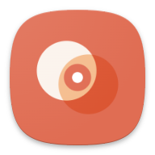
  <h1>Momento</h1>
  <p><strong>Share everyday moments with friends on Android</strong></p>
  
  
  
  
  
</div>

**Momento** is an Android app for sharing photos with friends. Capture a moment, choose who can see it, and revisit it later in your Journal. See photos from friends directly on your home screen with the widget, or reply to a moment from the feed and continue the conversation in a private chat.

---

## ✨ Key Features

| Feature | What you can do |
| --- | --- |
| **Capture and share moments** | Take a photo with the front or rear camera, or pick one from your gallery. Add a caption and share it with all friends, selected friends, or keep it private. |
| **Feed** | Swipe vertically through photos, filter by friend, react with emoji, and send a private reply to the person who posted. |
| **Journal** | Browse moments by date or filter by friend. **My Photos** includes private moments. See reactions to your own moments and delete photos you posted. |
| **Home screen widget** | Pin the widget from your profile on supported launchers. Choose one friend or use the next button in **All** mode. Tap the displayed photo to open its moment. |
| **One-to-one chat** | Send and receive text messages in real time, search conversations, and load older messages. Replies from the feed include a preview of the original moment. |
| **Friends and notifications** | Search by username, send and respond to friend requests, and manage your friends list. View incoming requests and acceptances in Notifications and mark them as read individually or all at once. |
| **Account and profile** | Sign in with Google or verify a Vietnamese phone number with a one-time code. Complete your profile on first sign-in and update your display name, birthday, and profile photo. |

## 🌐 System Overview

- **Momento Android** renders the UI, manages sign-in state, calls the backend API, and updates the widget. Room stores cached records, and photo previews are kept as local files.
- **Momento Backend** provides REST APIs for profiles, photos, friends, conversations, and notifications. It publishes events over STOMP and signals new photos through Firebase Cloud Messaging. The backend runs separately from the Android app.
- **Firebase** provides Firebase Authentication for sign-in and Firebase Cloud Messaging (FCM) for background widget updates.

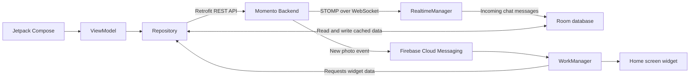

## 🛠️ Technology Stack

- **Kotlin**, **Jetpack Compose**, **Material 3**, **Navigation Compose**
- **MVVM**, **Kotlin Coroutines**, **Flow**, **Hilt**, **KSP**
- **Retrofit**, **OkHttp**, **Kotlinx Serialization**, **STOMP over WebSocket (Krossbow)**
- **CameraX**, **MediaStore**, **Coil**
- **Firebase Authentication**, **Credential Manager**, **Firebase Cloud Messaging**
- **Room**, **Preferences DataStore**, **WorkManager**, **AppWidgetProvider**, **RemoteViews**

## 📁 Project Structure

The Android app lives in the `:app` Gradle module. Source code is organized by feature, with `presentation`, `domain`, and `data` layers.

```text
app/src/main/java/com/example/momento/
├── app/              # Navigation and main screen
├── core/             # Database, Hilt, networking, sessions, and background work
├── feature/
│   ├── auth/         # Sign-in and profile setup
│   ├── chat/         # Conversations, messages, and replies to moments
│   ├── friend/       # User search and friend management
│   ├── moment/       # Camera, gallery, feed, and Journal
│   ├── notification/ # Friend request and acceptance history
│   ├── profile/      # Profile viewing and editing
│   └── widget/       # Widget settings, storage, and rendering
└── ui/               # Theme and shared Compose components
```

## 📱 Screenshots

<p align="center">
  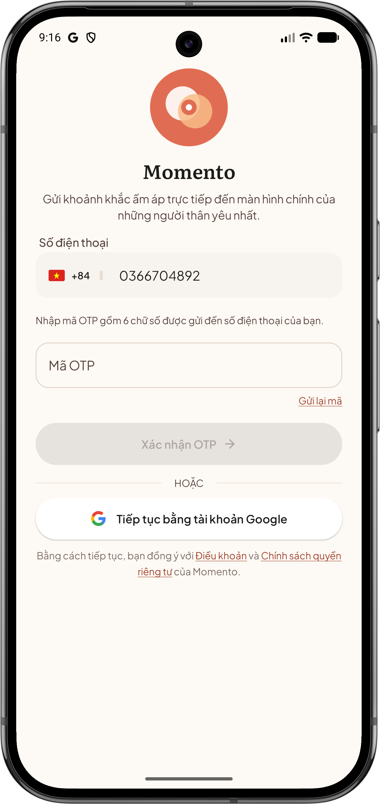
  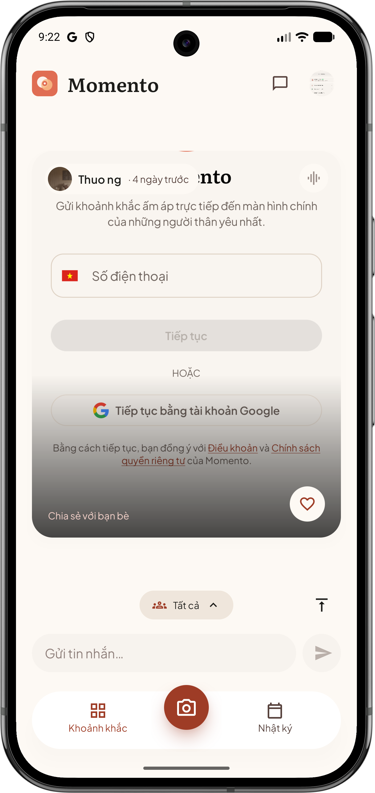
  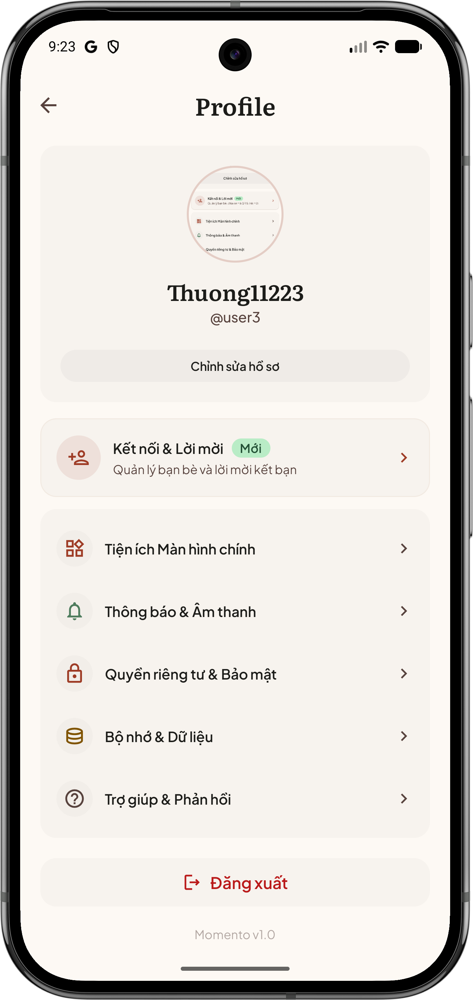
  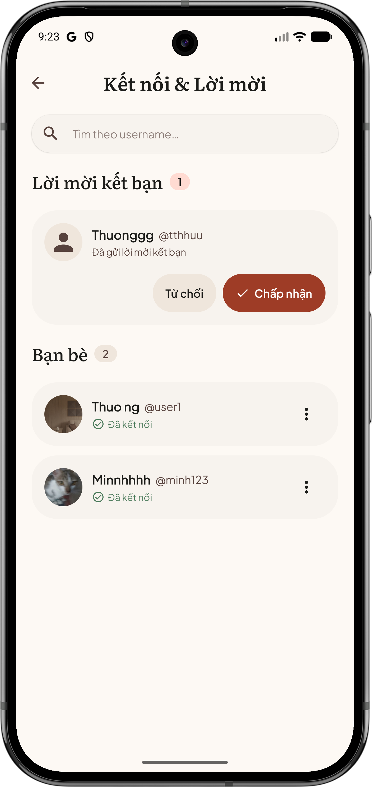
  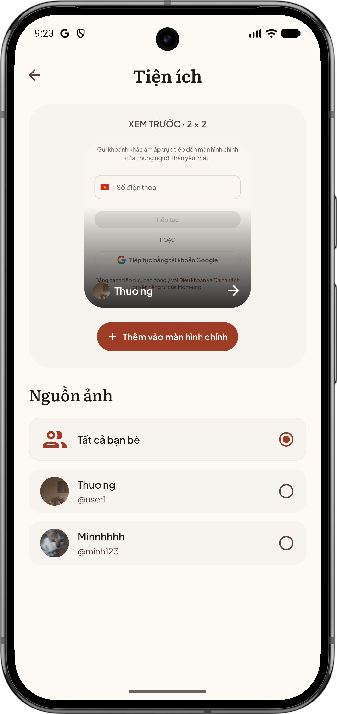
</p>

<p align="center">
  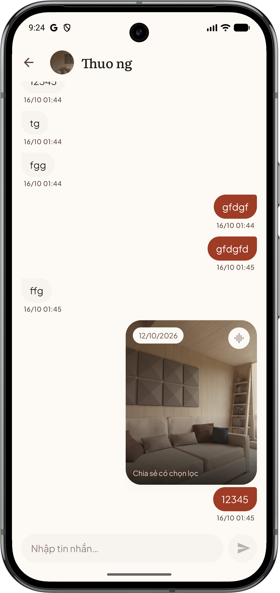
  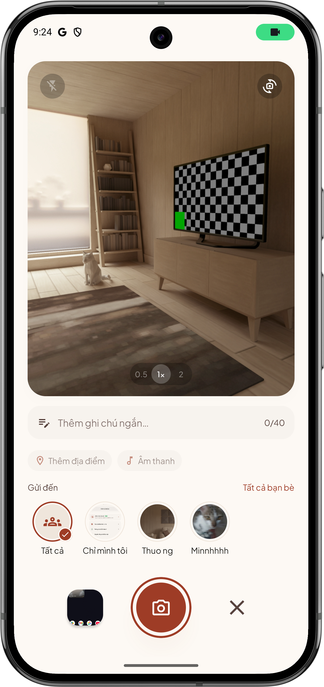
  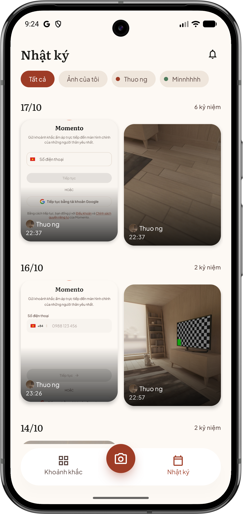
  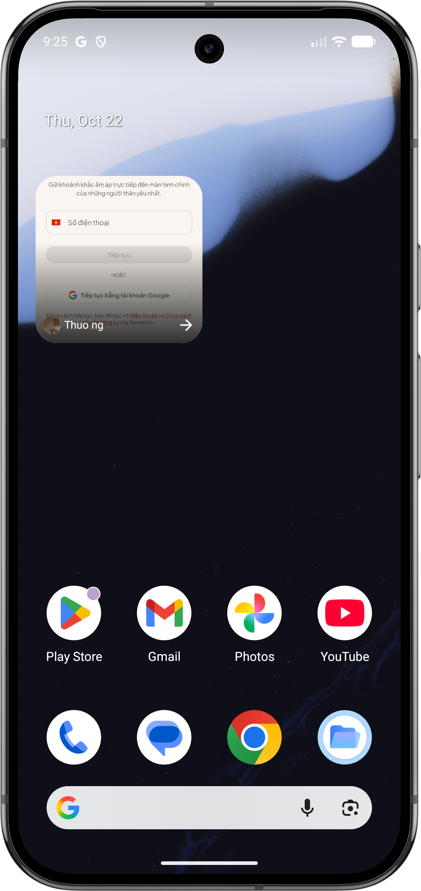
</p>

## 🚀 Getting Started

### Prerequisites

- An Android Studio version that supports **Android Gradle Plugin 9.3.2**. The project uses **Gradle Wrapper 9.5.0** and targets Java 17 source compatibility.
- **Android SDK API 37** to build the app. Both `compileSdk` and `targetSdk` are set to `37`. Run the app on a device or emulator with **Android 8.0 (API 26)** or later.
- A Momento backend that supports the app's REST and STOMP interfaces, and a Firebase project configured for both the backend and Android app. See [app/build.gradle.kts](app/build.gradle.kts) and the [Gradle Version Catalog](gradle/libs.versions.toml).

### 1. Clone the repository

```bash
git clone https://github.com/Thuong-actvn/Momento-Android.git
cd Momento-Android
```

### 2. Configure the backend URL

In `app/build.gradle.kts`, set `BACKEND_BASE_URL` in `defaultConfig` to an address your device or emulator can reach. Keep the trailing `/`.

```kotlin
buildConfigField("String", "BACKEND_BASE_URL", "\"http://10.0.2.2:8080/api/v1/\"")
```

This example uses the Android Emulator with the backend running on your development machine at port `8080`. On a physical device, use the backend's local network IP address or hostname. The app derives the `/ws/websocket` endpoint from this URL.

### 3. Configure Firebase

1. Register an Android app in Firebase Console with the package name `com.example.momento`.
2. Enable the **Google** and **Phone** sign-in providers in Firebase Authentication. Add the SHA-1 and SHA-256 fingerprints for the signing key used to build the app.
3. Download `google-services.json` and place it at `app/google-services.json`. The Google Services plugin generates the `default_web_client_id` resource used by Google Sign-In. Git ignores the Firebase configuration file.
4. To test background widget updates, configure the backend to send `NEW_PHOTO` FCM data messages to registered device tokens.

### 4. Build and install

Start the backend, open the project in Android Studio, and wait for Gradle Sync. Select a device and run the `app` configuration, or use the Gradle Wrapper from the repository root.

**Windows**

```powershell
.\gradlew.bat :app:assembleDebug
.\gradlew.bat :app:installDebug
```

**macOS / Linux**

```bash
sh ./gradlew :app:assembleDebug
sh ./gradlew :app:installDebug
```

## 👨‍💻 Contributors

- **Android developer** · [HoangVanThuong (Momento-Android)](https://github.com/Thuong-actvn/Momento-Android)
- **Backend developer** · [TrinhDacNhatMinh (locket-clone-backend)](https://github.com/TrinhDacNhatMinh/locket-clone-backend)

## 📄 License

MIT License.
